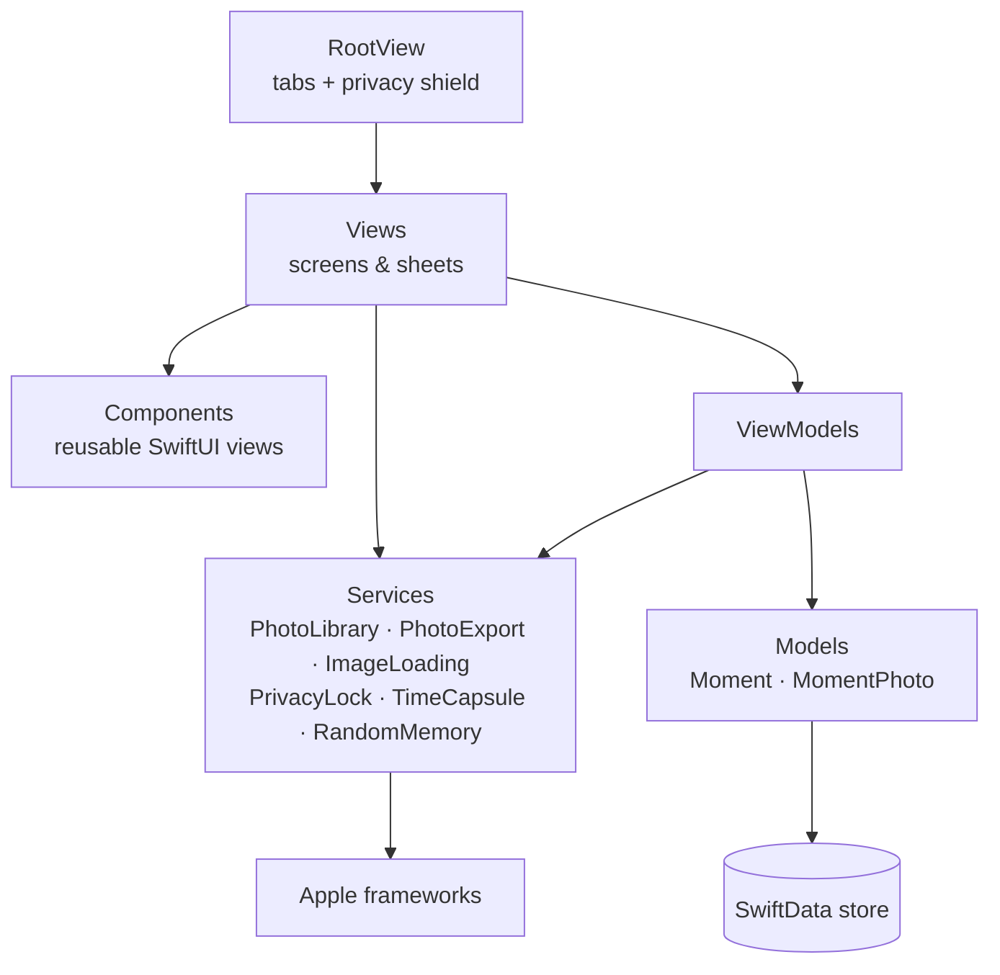

<div align="center">


# Momento

**A local-first iOS app for turning scattered camera-roll photos into moments worth revisiting.**

[](https://github.com/Selimo100/momento/actions/workflows/ci.yml)


</div>

## Overview

A camera roll is chronological, not meaningful. The evening at the lake, the
trip, the birthday — they all dissolve into one endless scroll.

Momento is an iOS app that lets you gather the photos that belong together into a
**moment**: a title, a date range, a mood, a story, the people who were there, a
place on the map, and the photos themselves. Moments can be presented in
different layouts, locked behind Face ID, or sealed as a **time capsule** that
cannot be opened until a date you choose.

The app is deliberately local-first. There is **no account, no backend, and no
analytics**. Photos are never copied — Momento stores only references to assets
in your Apple Photos library, so deleting a moment never touches your photos, and
exporting creates a real Photos album from the assets you already own.

## Features

| | |
| --- | --- |
| **Moments** | Title, date range, description, mood, story, people, notes, and a location picked from a map. |
| **Photos by reference** | Pick from Apple Photos via `PhotosPicker`; only asset identifiers are stored. Set a cover photo and mark best shots as favourites. |
| **Six presentation layouts** | Story, Timeline, Collage, Favorites Only, Photo Dump, and Before/After — chosen per moment. |
| **Completion score** | A weighted checklist (title, story, cover, five photos, best shot, …) that shows how fleshed out a moment is. |
| **Export to Apple Photos** | Create an album from all photos or favourites only, with an editable album name and honest handling of partial exports. |
| **Private Moments** | Moments hidden from the library and reachable only after Face ID / Touch ID, with a privacy shield in the app switcher. |
| **Time Capsules** | Seal a moment until a chosen date, with a local notification when it unlocks — plus lighter reminders to revisit a moment. |
| **Surprise me** | Resurface a random moment, a random best shot, something from this month, or something from around this date. |

## Tech stack

### Application

- **Swift 6** with strict concurrency
- **SwiftUI** — declarative UI, `TabView`-based navigation, `@Observable` services
- **SwiftData** — on-device persistence with lightweight-migration-safe models

### Apple frameworks

- **PhotosUI / Photos (PhotoKit)** — photo picking, image loading, album export
- **LocalAuthentication** — Face ID / Touch ID for Private Moments
- **UserNotifications** — Time Capsule unlock and reminder notifications
- **Contacts / ContactsUI** — tagging people in a moment
- **MapKit** — location search and selection

### Tooling

- **XcodeGen** (`project.yml`) as the readable project specification
- **SwiftLint** for code style, configured in `.swiftlint.yml`
- **GitHub Actions** for CI, **Xcode Cloud** for device builds

There are no third-party runtime dependencies.

## Architecture



The layering rule is simple: **views never call system APIs directly.** Every
interaction with PhotoKit, LocalAuthentication, notifications, or Contacts is
wrapped in a service, so permission handling and error mapping live in exactly
one place per capability.

See **[docs/architecture.md](docs/architecture.md)** for the data model, the
export and privacy flows, and the reasoning behind the persistence decisions.

## Project structure

```text
.
├── Momento/
│   ├── App/            # MomentoApp entry point, Info.plist, model container
│   ├── Models/         # SwiftData models: Moment, MomentPhoto, layout, completion
│   ├── Views/          # One file per screen or sheet
│   ├── Components/     # Reusable presentational views and photo layouts
│   ├── ViewModels/     # Screen-scoped state for the list and detail screens
│   ├── Services/       # All access to PhotoKit, biometrics, notifications
│   ├── Utilities/      # Date, colour, layout, and permission helpers
│   └── Assets.xcassets # App icon and accent colour
├── docs/               # Architecture documentation
├── .github/            # CI workflow, issue forms, PR template, Dependabot
├── project.yml         # XcodeGen project specification
└── Momento.xcodeproj   # Committed Xcode project (built by CI and Xcode Cloud)
```

## Getting started

### Prerequisites

- macOS with **Xcode 26** or newer — the app targets iOS 26
- An iOS 26 Simulator, or an iPhone plus an Apple Developer account for device builds
- Optional: `brew install xcodegen swiftlint` for project generation and linting

### Installation

```bash
git clone git@github.com:Selimo100/momento.git
cd momento
open Momento.xcodeproj
```

No dependency installation is required — the app uses only Apple frameworks.

### Running locally

Select the **Momento** scheme and an iOS 26 Simulator, then press ⌘R.

To run on a physical device, set your team under
*Signing & Capabilities* first. Some features are simulator-limited: Face ID can
be simulated from *Features → Face ID*, and the Photos library will contain only
the simulator's sample images.

From the command line:

```bash
xcodebuild build \
  -project Momento.xcodeproj \
  -scheme Momento \
  -destination 'generic/platform=iOS Simulator' \
  CODE_SIGNING_ALLOWED=NO
```

### Configuration

Momento has no environment variables and no secrets: there is no network layer to
configure. The only build-time configuration lives in `project.yml` and
`Momento/App/Info.plist` (bundle identifier, version, and the permission usage
descriptions). Signing is configured per developer and must never be committed.

Runtime preferences — accent colour and the default album prefix used on export —
are stored locally with `@AppStorage` and can be changed in the app's Settings
tab.

### Linting

```bash
swiftlint          # check
swiftlint --fix    # apply autocorrectable rules
```

### Tests

The project does not yet have an automated test target; CI verifies that the app
compiles and that SwiftLint is clean. The pure logic worth covering first is
listed under *Known gaps* in [docs/architecture.md](docs/architecture.md), and
contributions there are welcome.

## Development

- Branch from `main` using `feature/…`, `fix/…`, `docs/…`, `refactor/…`, or `chore/…`.
- Commit messages follow [Conventional Commits](https://www.conventionalcommits.org/).
- Every pull request runs CI: an iOS Simulator build, SwiftLint, and validation of
  the XcodeGen spec.
- SwiftData model changes must stay lightweight-migration safe — new stored
  properties are optional or carry a default.

Details are in [CONTRIBUTING.md](CONTRIBUTING.md).

## Releases

Releases follow semantic versioning (`MAJOR.MINOR.PATCH`) via the target's
`MARKETING_VERSION`, with `CURRENT_PROJECT_VERSION` as the build number. Changes
are collected under `Unreleased` in [CHANGELOG.md](CHANGELOG.md) and cut into a
version section when a build is tagged and distributed through TestFlight.

## Privacy

Momento is built local-first, and the architecture enforces it:

- no account, no backend, no analytics, no third-party SDKs
- the photo library is read only for assets the user explicitly selects
- albums are created in Apple Photos only after an explicit export action
- deleting a moment removes Momento's data, never the original photos
- Private Moments are unlocked per foreground session and re-lock on backgrounding

## Contributing

Contributions are welcome — see [CONTRIBUTING.md](CONTRIBUTING.md) for setup,
conventions, and the pull request process. Bugs and ideas go through the
[issue forms](.github/ISSUE_TEMPLATE).

## Security

Please report vulnerabilities privately rather than in a public issue. The
process is described in [SECURITY.md](SECURITY.md).

## License

No license has been chosen yet, so all rights are reserved by default. If you
would like to reuse any part of this project, please open an issue first.
