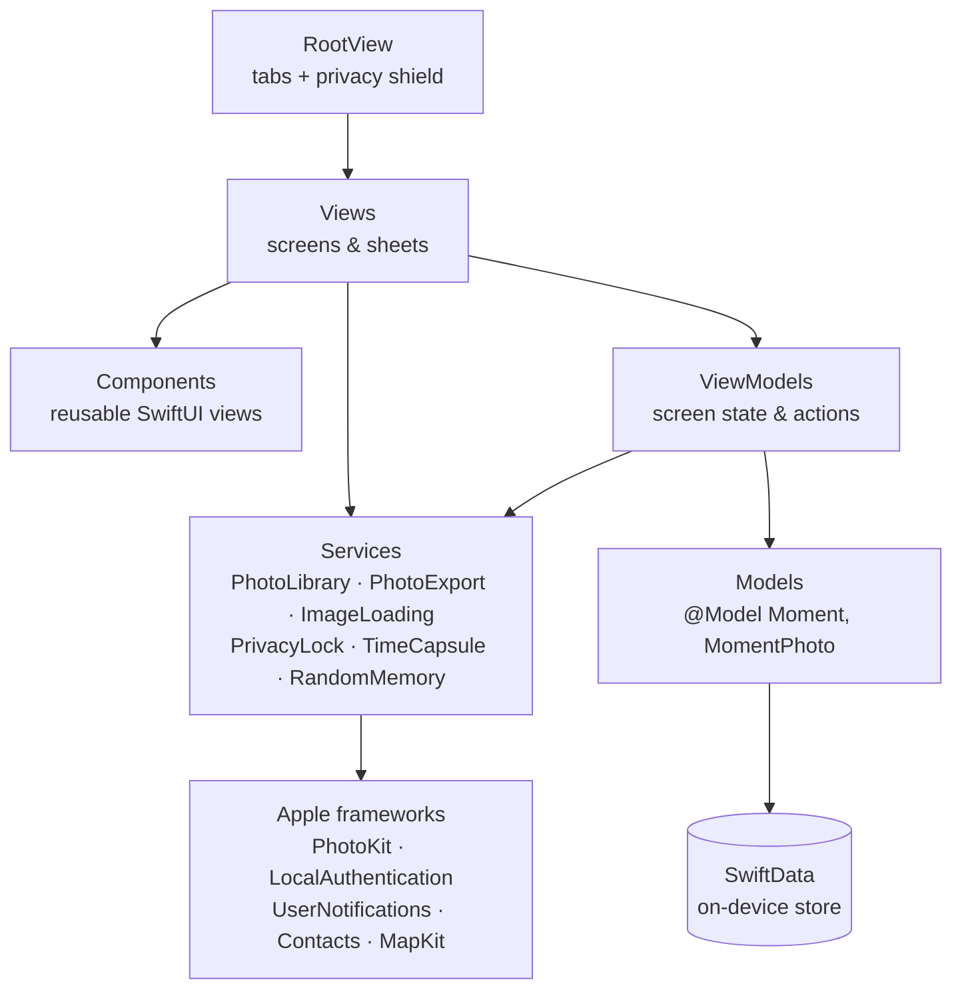
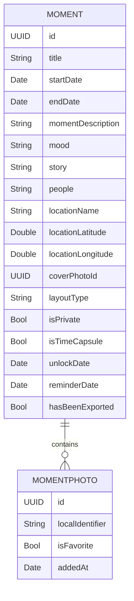
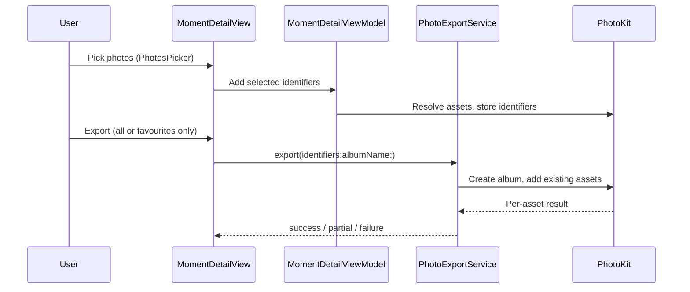

# Architecture

Momento is a single-target SwiftUI application for iOS 26. It has no backend and
no third-party dependencies — every capability comes from an Apple framework.
This document describes how the app is organised and why.

## Layers

The rule that keeps this readable: **views never talk to Apple's system APIs
directly.** Anything involving `PHPhotoLibrary`, `LAContext`,
`UNUserNotificationCenter`, or the Contacts store is wrapped by a service in
`Momento/Services`, so permission handling and error mapping live in one place
per capability.

| Directory | Responsibility |
| --- | --- |
| `Momento/App` | App entry point (`MomentoApp`) and `Info.plist`, including the SwiftData model container. |
| `Momento/Models` | SwiftData `@Model` types and value types derived from them (layout, completion). |
| `Momento/Views` | Full screens and sheets — one file per screen. |
| `Momento/Components` | Presentational, reusable views: cards, photo layouts, buttons, empty states. |
| `Momento/ViewModels` | Screen-scoped state and actions for the list and detail screens. |
| `Momento/Services` | All access to system frameworks, plus the derived-data logic on top of it. |
| `Momento/Utilities` | Small extensions: date formatting, hex colours, adaptive layout, permission helpers. |

## Data model

Two SwiftData entities, in a one-to-many relationship with cascading delete:

Two decisions matter here:

**Photos are referenced, never copied.** `MomentPhoto` stores only the Apple
Photos `localIdentifier`. Images are fetched on demand through
`ImageLoadingService`, and deleting a moment never touches the user's library.
This keeps the on-device store tiny and means Momento is not a second copy of
the user's photo collection.

**The schema is migration-safe by construction.** Every property added after the
initial release is optional or has a default value, so SwiftData can perform a
lightweight migration and existing users keep their moments. `layoutType` is
persisted as a raw `String` rather than an enum for the same reason:
`MomentLayoutType.resolve(_:)` maps unknown values back to a safe default
instead of failing to decode.

## Feature flows

### Adding and exporting photos

`PhotoExportService` returns an explicit `ExportResult` — `success`, `partial`,
or `failure` — instead of throwing, because a partial export (some assets have
since been deleted from the library) is a normal outcome the UI must show
honestly rather than an error.

### Private Moments

Private moments are excluded from every normal query and are only reachable
through `PrivateMomentsView`, which is gated by `PrivacyLockService`
(LocalAuthentication, Face ID / Touch ID / passcode).

The unlocked state is intentionally **in-memory only**. `RootView` observes
`scenePhase`: as soon as the app leaves the foreground it re-locks the session
and, if private content could be on screen, covers the UI with a privacy shield
so nothing sensitive appears in the app switcher.

### Time Capsules

A moment can be sealed with an `unlockDate`. Until that date it renders as
`TimeCapsuleLockedView` and its photos are not shown; afterwards it becomes
"ready to reopen". `TimeCapsuleService` owns the `UNUserNotificationCenter`
interaction and schedules two independent kinds of local notification: an unlock
notification for sealed capsules, and a reminder notification for moments the
user simply wants to revisit later.

Because the unlock condition is a stored date evaluated at read time, capsules
behave correctly even if the app is never launched between sealing and unlocking.

### Presentation layouts and completion

`MomentLayoutType` selects one of six photo layouts (Story, Timeline, Collage,
Favorites Only, Photo Dump, Before/After), each implemented as its own component
in `Momento/Components`. `MomentCompletion` computes a weighted completeness
score from the criteria a moment satisfies (title, description, story, cover
photo, photo count, best shot, and so on) and drives the completion card that
nudges users to enrich a moment.

`RandomMemoryService` implements the surprise modes — random moment, random best
shot, this month, around this date — as pure queries over the existing store; no
extra state is persisted for them.

## External integrations

| Framework | Used for | Declared in `Info.plist` |
| --- | --- | --- |
| PhotosUI / Photos | Picking photos, loading images, creating albums | `NSPhotoLibraryUsageDescription`, `NSPhotoLibraryAddUsageDescription` |
| LocalAuthentication | Unlocking Private Moments | `NSFaceIDUsageDescription` |
| Contacts / ContactsUI | Tagging people in a moment | `NSContactsUsageDescription` |
| UserNotifications | Time Capsule unlock and reminder notifications | requested at runtime |
| MapKit | Searching and picking a location for a moment | requested at runtime |
| SwiftData | On-device persistence | — |

## Build configuration

`project.yml` is the XcodeGen specification describing the target, deployment
target, and build settings. The generated `Momento.xcodeproj` is committed as
well, because Xcode Cloud and GitHub Actions build from it directly and because
signing settings are configured in it locally. See
[CONTRIBUTING.md](../CONTRIBUTING.md#the-xcode-project-and-projectyml) for how to
change build settings safely.

## Known gaps

- There is no automated test target yet. The most valuable first targets would be
  the pure logic: `MomentCompletion` scoring, `MomentLayoutType.resolve(_:)`,
  the capsule state derivation on `Moment`, and `RandomMemoryService` selection.
- `MomentDetailView` is the largest file in the project and is a reasonable
  candidate for extracting further components.
